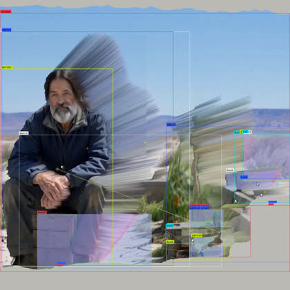
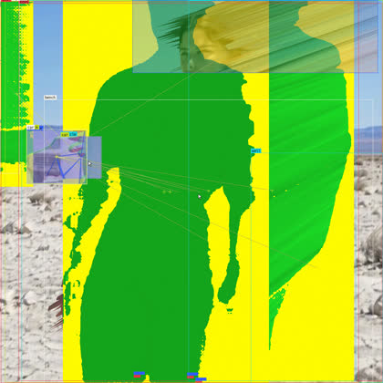
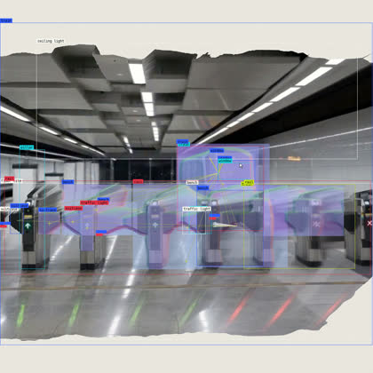
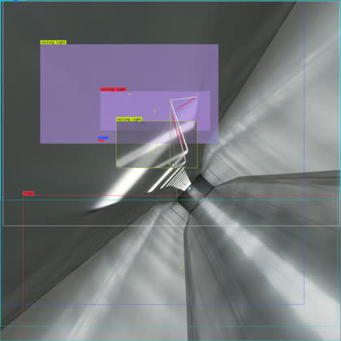

# depth-mesh-film

AI で生成した動画と物体検出の技術を使って作った映像の制作コードです。
Runway で生成した人物と建物の映像を、AI で推定した奥行きで簡易的に3D化し、場面と場面をモーフィングでつないだ上に、物体検出（YOLO）などの解析結果をエフェクトとして重ねています。

Code for a short looping film: Runway-generated footage is turned into textured depth meshes in Blender, scenes are joined with AI morphs, and real computer-vision output (YOLO detection, SAM masks, surface normals, feature points) is composited on top.

| | |
|---|---|
|  |  |
|  |  |

完成映像（人物版 20.8秒・建築版 28.0秒、1280×1280・30fps）は [Releases](https://github.com/AtsuyaTsuchida/depth-mesh-film/releases) にあります。

## 作り方

1. **素材を作る**（`runway_gen.py`）
   Runway で人物と建物の画像・動画を生成します。場面の間のモーフは、前の場面の最後のコマと次の場面の最初のコマを指定して生成します（h3_max のキーフレーム指定）。
2. **奥行きを推定する**（`film_prep.py`）
   Depth Anything V2 で深度を推定し、800×450 の格子の距離にします。動画は全コマまとめて正規化し、距離が揺れないようにしています。
3. **深度メッシュにする**（`film_scene.py`、Blender 4.5）
   写真を貼ったメッシュを作り、奥行きが急に変わる面は破ります。少し奥に破らない複製を置き、裂け目が引き伸ばされた画素の筋で埋まるようにしています。カメラはどの区間も写真と同じ視点で始まって終わるので、つなぎ目は見えません。
4. **つなぐ**（`film_edit.py`、構成は `film_plans.py`）
   場面とモーフを6コマ重ねてつなぎ、ループにします。
5. **解析する**（`analyze.py`）
   YOLO-World と YOLO11 で物体を検出して追跡し、SAM 2.1 でマスク、深度の勾配で面の向き、ORB で特徴点を取ります。
6. **重ねて仕上げる**（`film_composite.py`）
   解析結果を枠とラベル、ラベンダー色の面の向き、黄色地に緑の人型、点を結ぶ線として重ね、モーフ中は人物の頭の残像を並べます。最後に色を整えて書き出します。

## 必要なもの

- macOS（Apple Silicon で確認）
- Blender 4.5（`/Applications/Blender.app`）
- Python 3 と `requirements.txt` のパッケージ
- ffmpeg
- 素材を作り直す場合は Runway API のキー

```bash
python3 -m venv .venv
.venv/bin/pip install -r requirements.txt
```

物体検出とマスクのモデル（YOLO-World v2、YOLO11m、SAM 2.1 base）は、初回実行時に `models/` へダウンロードされます。

Runway API のキーは環境変数 `RUNWAYML_API_SECRET` で渡すか、このフォルダの `.env` に `RUNWAYML_API_SECRET=...` と書きます（`.env` は Git に含めません）。`runway_gen.py` は既定では見積もりと残高を表示するだけで、`--run` を付けたときだけ生成します。

## 実行

素材を用意したあと、各場面を準備して区間を描き、作品ごとにつないで仕上げます。

```bash
.venv/bin/python film_prep.py video walker runway/walker.mp4 2 80
/Applications/Blender.app/Contents/MacOS/Blender -b -P film_scene.py -- walker2
.venv/bin/python film_edit.py people
.venv/bin/python analyze.py peoplebase
.venv/bin/python film_composite.py people
```

両作品をまとめて作り直すときは `scripts/run_cam.sh`（場面の区間だけ描き直す）か `scripts/run_both.sh` を使います。

## ファイル

| ファイル | 内容 |
|---|---|
| `runway_gen.py`, `runway_api.py` | Runway での素材・モーフ生成 |
| `film_prep.py` | 深度推定と格子・縁のマスク |
| `film_scene.py` | Blender の深度メッシュとカメラ（区間ごとの設定） |
| `film_plans.py`, `film_edit.py` | 作品の構成とつなぎ |
| `analyze.py` | 物体検出・追跡・マスク・法線・特徴点 |
| `film_composite.py` | エフェクトの重ねと色の仕上げ |
| `depth.py`, `points.py`, `scene*.py`, `video_points.py`, `composite.py` | 初期の点群版の試作 |
| `sound/` | 解析結果に合わせて Max 8 の gen~ で音を鳴らす試み（最終版では未使用） |

## 参考

手法は Ingi Erlingsson の [「tread lightly」](https://x.com/ingi_erlingsson/status/2106567435826446624) を参考にしました。このリポジトリの映像・画像はすべて作者が用意した素材から作ったもので、参考作品の映像は含みません。

## ライセンス

コードは [MIT License](LICENSE) です。`docs/` の画像と Releases の映像は © 2026 Atsuya Tsuchida で、無断での使用はできません。
